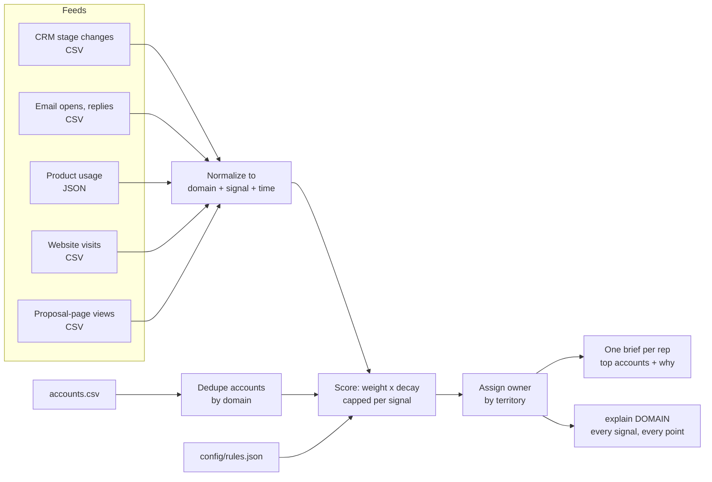

<picture>
  <source media="(prefers-color-scheme: dark)" srcset=".github/banner-dark.svg">
  
</picture>

<p>
  <a href="https://github.com/joshuaforwork10-sys/signal-scoring-engine/actions/workflows/tests.yml"></a>
  
  
  
</p>

<h1 align="left">signal-scoring-engine</h1>

Nightly account scoring for B2B SaaS: reads CRM, email, product, web and proposal-page events, scores every account with weighted, time-decayed rules, and writes each rep a markdown brief that says who to call and why.



## Quickstart

Python 3.10+ and nothing else to run it. `pytest` only for the tests.

```bash
git clone https://github.com/joshuaforwork10-sys/signal-scoring-engine && cd signal-scoring-engine
python3 -m signal_engine run --dry-run      # score and report, write nothing
python3 -m signal_engine run                # write out/briefs/<rep>.md
python3 -m signal_engine explain northwind-logistics.example
```

Run the tests with `python3 -m pytest -q`.

## Sample output

From a real run against the sample feeds in `data/`:

```text
$ python3 -m signal_engine run
as of 2025-06-02 08:18 | 8 accounts after domain dedupe | 34 events
    56.5  contosohealth.example           Morgan Avery
    33.0  northwind-logistics.example    Jordan Kim
    28.2  fabrikam.example               Jordan Kim
    10.7  wingtippay.example             Morgan Avery
     2.8  litware.example                 Sasha Novak
     0.2  adventure-works.example         Jordan Kim
   -23.3  tailspintravel.example         Riley Chen
   -38.8  proseware.example              Sasha Novak
skipped: email_forwarded (1)
wrote       out/briefs/jordan-kim.md
wrote       out/briefs/morgan-avery.md

$ python3 -m signal_engine run | tail -2
unchanged   out/briefs/jordan-kim.md
unchanged   out/briefs/morgan-avery.md
```

`out/briefs/jordan-kim.md`:

```markdown
# Rep brief: Jordan Kim

Signals as of 2025-06-02 08:18. Top 5 accounts by score.

| # | Account | Domain | Score |
|---|---|---|---|
| 1 | Northwind Logistics | northwind-logistics.example | 33.0 |
| 2 | Fabrikam Robotics | fabrikam.example | 28.2 |

## 1. Northwind Logistics (33.0)
- Opened the proposal page x1: +13.9 (latest 0.1d ago)
- Replied to an email x1: +9.8 (latest 2d ago)
- Viewed pricing x1: +6.1 (latest 0.8d ago)
- Opened an email x3: +2.3 (latest 0.8d ago)
- Visited the website x1: +0.8 (latest 0.8d ago)

## 2. Fabrikam Robotics (28.2)
- Started a trial x1: +12.3 (latest 7.8d ago)
- Invited a teammate x2: +8.3 (latest 5d ago)
- Moved to discovery x1: +4.2 (latest 13d ago)
- Active in the product x1: +3.5 (latest 0.6d ago)
```

`explain` shows every event behind one score, including the two CRM records that were merged by domain:

```text
$ python3 -m signal_engine explain northwind-logistics.example
Northwind Logistics (northwind-logistics.example)  score 33.0  owner Jordan Kim
merged records: A-100, A-101 | region US-East | 820 employees
as of 2025-06-02 08:18

  signal                 when                 age  points  detail
  proposal_view          2025-06-02 06:30   0.1d  +13.86  dana.lee@northwind-logistics.example, 240s
  web:visit              2025-06-01 14:07   0.8d   +0.84  /customers
  web:pricing            2025-06-01 14:05   0.8d   +6.14  /pricing
  email_open             2025-06-01 13:20   0.8d   +0.90  sam.ortiz@northwind-logistics.example
  email_reply            2025-05-31 08:02   2.0d   +9.83  dana.lee@northwind-logistics.example
  email_open             2025-05-31 07:55   2.0d   +0.76  dana.lee@northwind-logistics.example
  email_open             2025-05-30 08:10   3.0d   +0.66  dana.lee@northwind-logistics.example

why:
  - Opened the proposal page x1: +13.9 (latest 0.1d ago)
  - Replied to an email x1: +9.8 (latest 2d ago)
  - Viewed pricing x1: +6.1 (latest 0.8d ago)
  - Opened an email x3: +2.3 (latest 0.8d ago)
  - Visited the website x1: +0.8 (latest 0.8d ago)
```

## How scoring works

Each signal in `config/rules.json` has a weight, a half-life and a cap:

```json
"proposal_view": {"weight": 14, "half_life_days": 5, "max_count": 3, "label": "Opened the proposal page"}
```

An event is worth `weight x 0.5 ^ (age_days / half_life_days)`. A proposal view today is worth 14 points, five days later 7. `max_count` keeps the newest N events of a type, so seven email opens cannot outscore one reply. Negative weights (unsubscribe, closed lost) pull an account down the list.

Territories are an ordered list in the same file. The first rule that matches wins, so the enterprise rule (`min_employees: 1000`) sits above the regional ones.

## Design decisions

- **Rules before models.** Every point traces back to a line in a config file a sales leader can read and change. A rep who disagrees with a score can run `explain` and see exactly why. A model can come later, once the rules show which signals matter.
- **Domain is the join key.** CRMs collect duplicate accounts. Normalizing `https://www.northwind-logistics.example` and `northwind-logistics.example/about` to one domain before scoring stops one company from showing up twice with half the signal each.
- **Read-only dry run first.** `--dry-run` scores everything and lists the files it would write, and writes nothing. That is the first thing to run against new data.
- **Idempotent writes.** A brief only depends on the input data and the as-of time, never on when the job ran. A rerun with the same data leaves files untouched, and each write goes to a temp file first, so a rep never opens half a brief.
- **Unknown signals are reported, never guessed.** An event type the config does not know (`email_forwarded` in the sample) is counted and printed, so a new feed field shows up as a visible gap instead of a silent zero.

## Layout

```text
config/rules.json        signal weights, half-lives, caps, territories
data/                    sample feeds (fabricated companies)
signal_engine/engine.py  load, dedupe, score, assign owner
signal_engine/brief.py   render and write rep briefs
signal_engine/__main__.py  CLI: run, explain
tests/                   pytest suite
```

## License

MIT
